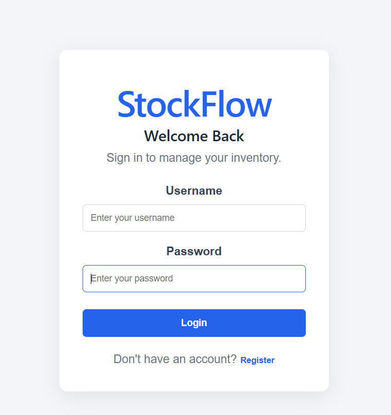
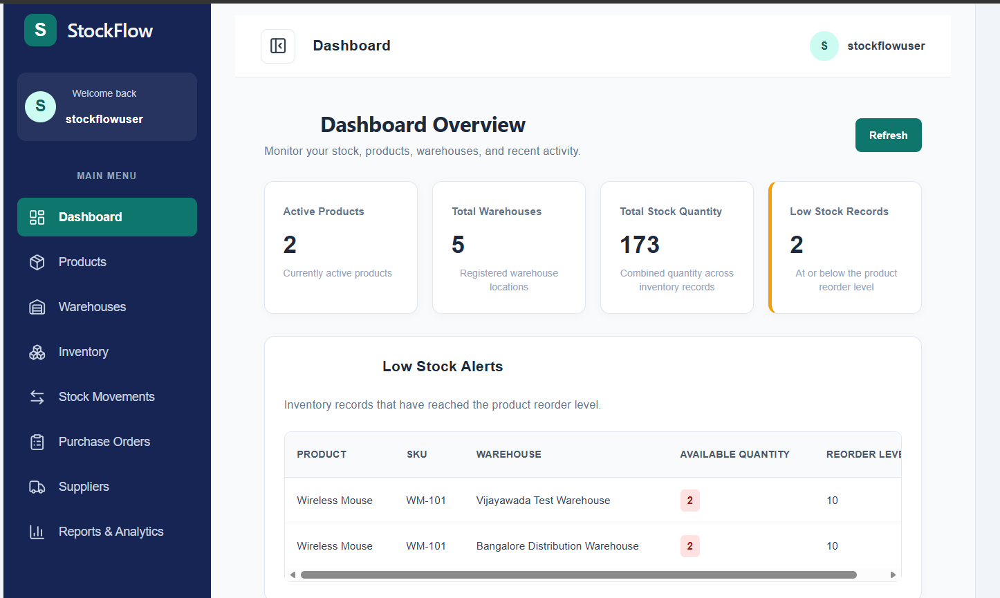

# StockFlow – Inventory & Warehouse Management System

StockFlow is a full-stack inventory and warehouse management application designed to help businesses manage products, suppliers, warehouses, stock levels, stock movements, and purchase orders through a centralized dashboard.

## Features

- **Dashboard:** Overview of inventory and warehouse activity.
- **Product Management:** Create, view, update, and manage products.
- **Supplier Management:** Maintain supplier information.
- **Warehouse Management:** Manage warehouse details and status.
- **Inventory Management:** Track stock quantities across warehouses.
- **Stock Movements:** Manage stock-in, stock-out, and stock transfers.
- **Purchase Orders:** Create and manage purchase orders.
- **Reports & Analytics:** View inventory-related reports and export data as CSV.
- **Authentication:** User registration and login with JWT-based authentication.
- **Security:** Spring Security and BCrypt password hashing.
## Application Screenshots

### Login Page



### Dashboard




## Technology Stack

### Backend
- Java 21
- Spring Boot 4.1.2
- Spring Data JPA
- Spring Security
- JWT Authentication
- PostgreSQL
- Flyway Database Migration
- Maven
- JUnit and H2 for testing

### Frontend
- React 19
- Vite
- JavaScript
- CSS
- Lucide React

## Project Structure

```text
StockFlow/
│
├── stockflow-backend/
│   ├── src/
│   │   ├── main/
│   │   │   ├── java/com/stockflow/
│   │   │   └── resources/
│   │   │       ├── db/migration/
│   │   │       └── application.properties
│   │   └── test/
│   ├── mvnw
│   ├── mvnw.cmd
│   └── pom.xml
│
├── stockflow-frontend/
│   ├── public/
│   ├── src/
│   ├── package.json
│   └── vite.config.js
│
└── .gitignore
```

## Prerequisites

Install the following before running the application:

- Java Development Kit (JDK) 21
- PostgreSQL
- Node.js and npm
- Git

## Getting Started

### 1. Clone the Repository

```bash
git clone <YOUR_GITHUB_REPOSITORY_URL>
cd StockFlow
```

### 2. Configure the Database

Start PostgreSQL and create a database named:

```sql
CREATE DATABASE stockflow_db;
```

The application uses Flyway to manage database migrations automatically when the backend starts.

### 3. Configure Backend Environment Variables

The backend requires database credentials and a JWT secret.

In PowerShell, configure the following environment variables:

```powershell
$env:DB_URL = "jdbc:postgresql://localhost:5432/stockflow_db"
$env:DB_USERNAME = "postgres"
$env:DB_PASSWORD = "your_postgresql_password"
```

Generate a secure JWT secret:

```powershell
$bytes = New-Object byte[] 64
[System.Security.Cryptography.RandomNumberGenerator]::Fill($bytes)
$env:JWT_SECRET = [Convert]::ToBase64String($bytes)
```

The JWT expiration time defaults to 86400000 milliseconds (24 hours). You can override it using:

```powershell
$env:JWT_EXPIRATION = "86400000"
```

**Important:** Never commit actual passwords, JWT secrets, or other credentials to GitHub.

### 4. Run the Backend

Open a terminal in the project root and execute:

```powershell
cd stockflow-backend
.\mvnw.cmd spring-boot:run
```

The backend starts at:

```text
http://localhost:8081
```

### 5. Run the Frontend

Open a second terminal in the project root and execute:

```powershell
cd stockflow-frontend
npm install
npm run dev
```

The frontend will be available at:

```text
http://localhost:5173
```

Vite is configured to proxy `/api` requests to the backend running on port `8081`.

### 6. Create an Account

Open the frontend in your browser, register a new account, and log in to access the application.

## Running Tests

### Backend Tests

From the `stockflow-backend` directory:

```powershell
.\mvnw.cmd clean test
```

The backend test configuration uses an H2 in-memory database, so the tests do not require the PostgreSQL database.

### Frontend Build

From the `stockflow-frontend` directory:

```bash
npm run build
```

### Frontend Lint

```bash
npm run lint
```

## Security

- Passwords are hashed using BCrypt.
- Authentication is handled using JWT.
- Protected API requests require a valid bearer token.
- Database credentials and JWT secrets are supplied through environment variables.
- Never publish real credentials or secret keys in the repository.

## Author

Developed as a full-stack software development project using Java, Spring Boot, PostgreSQL, React, and modern web technologies.
